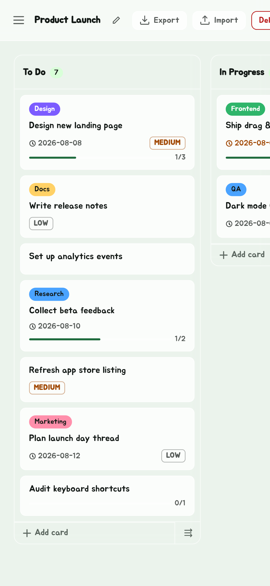
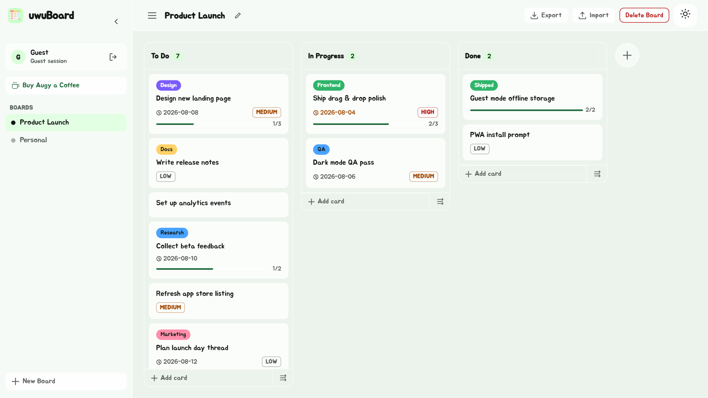

# uwuBoard

The Kanban way: turn your to-do list into a clear board where you drag tasks from To Do to Done.

uwuBoard is a web app (PWA) by Augy Studios, and an app for Android, Windows, macOS and Linux. Use
it as a guest with everything kept on your device, or sign up and your boards follow you to any
device.

**Download the apps:** <https://github.com/augy-studios/uwuboard/releases/latest>

| Phone | Desktop |
| --- | --- |
|  |  |

## Features

- **Boards:** as many as you like; rename and delete them. Each is a **Kanban** board or a
  **Timeline**, and can switch between the two at any time.
- **Timeline:** a Gantt chart of the same cards, like Jira's Timeline: columns become phases,
  cards become bars from their start to their due date. Drag to move or resize, zoom by weeks,
  months or quarters, milestones, progress from checklists, a today line, and dependencies whose
  arrows turn red when the dates clash.
- **Columns:** add, rename, delete and drag to reorder.
- **Cards:** title, description, due date, priority, colour labels, checklists and images; drag
  them between columns.
- **Guest mode:** no account needed. Boards live in `localStorage`, and you can export them as JSON
  and import them in another browser.
- **Accounts:** username, email and password, with 30-day sessions. Edit your display name and
  avatar, or delete your account.
- **Themes:** seven brand colour swatches and a light, dark or time-based mode.
- **Sync between devices:** boards and theme copied straight from one device to another over
  WebRTC, with a code or QR code.
- **Report a bug:** from the edge tray, in the site and the apps. What went wrong, a way to reach
  you, and up to three pictures, from the device or **Screenshot a page**: go to the page with the
  bug and take it whole, top to bottom. It reaches Augy through a Telegram bot, and you get the
  report's ID (like `20261114-7K3Q`) to quote. See "Report a bug" below.
- **PWA:** installable and works offline. When a new version is ready, a bar at the top offers to
  reload.

## The apps

One Flutter project (`flutter/`) builds Android and the three desktop apps, with every feature the
website has, under the same storage keys and API:

- **Android**: Material You by default, with the site's UwU Apps look a switch away in Theme; an
  Updates page listing every version, updating itself from GitHub Releases; notifications of new
  versions through Firebase (`flutter/FIREBASE-SETUP.md`). Also on Google Play (`GOOGLE-PLAY.md`).
- **Windows, macOS and Linux**: their own title bar and command bar (`Ctrl+K`), the boards beside
  the open one, the tray with due-card notifications and a tray countdown, desktop widgets, the
  Jump List and Dock, screenshots, and self-updating installers built by GitHub Actions.

`flutter/README.md` says how to build them; `release/README.md` how to publish a version.

## Repository layout

```
main-site/          The web app, deployed to Vercel
  index.html        Single-page app shell
  script.js         Board, card and account logic
  style.css         Styles
  js/               Timeline, device sync, edge tray, tours, theme, images, update bar
  sw.js             Service worker (offline cache)
  api/              Vercel serverless functions
    auth/           register, login, logout, update-profile, update-avatar, delete-account
    boards/         list, get, create, update, delete
    images/         upload, delete (card images)
    lib/            Supabase client and session check
    app-release.js  The newest Android release, for the app's updater
    push/           release.js: GitHub's webhook, pushing "a new version is out" through FCM
flutter/            The Android, Windows, macOS and Linux apps (flutter/README.md)
release/            The built APK and App Bundle, each version in a folder (release/README.md)
announcements/      Release notes for GitHub and Google Play, and Telegram announcements
docs/               Specs for features and for the apps, and the store's screenshots
  assets/           The app icon's SVG source
  phone-assets/, tablet-assets/, desktop-assets/, feature-graphic.png   Google Play's images
migrations/         SQL for the Supabase SQL editor, run in number order
.github/workflows/  Build desktop apps: the installers, on every release
```

## Tech stack

- Plain HTML, CSS and JavaScript on the front end, with no framework and no build step.
- [Vercel](https://vercel.com) serverless functions (Node.js) for the API, in the `sin1` region.
- [Supabase](https://supabase.com) for Postgres and file storage.
- `bcryptjs` for password hashing.

## Running it locally

You need Node.js, the [Vercel CLI](https://vercel.com/docs/cli) and a Supabase project.

```sh
cd main-site
npm install
vercel dev
```

Guest mode works without a backend. Accounts, synced boards and images need the Supabase setup below.

### Environment variables

Set these in the Vercel project, or in `main-site/.env.local` for `vercel dev`.
[main-site/.env.example](main-site/.env.example) lists them:

| Variable | What it is |
| --- | --- |
| `SUPABASE_URL` | Your Supabase project URL |
| `SUPABASE_SERVICE_KEY` | The service role key. It is only used server side, so never expose it to the browser. |
| `FIREBASE_SERVICE_ACCOUNT`, `GITHUB_WEBHOOK_SECRET`, `GITHUB_TOKEN` | Optional: notifications of new app versions (`flutter/FIREBASE-SETUP.md`) |
| `BUG_REPORT_BOT_TOKEN`, `BUG_REPORT_CHAT_ID` | Optional: where Report a bug sends reports ("Report a bug" below). Without them the form offers email instead |
| `KV_REST_API_URL`, `KV_REST_API_TOKEN` | Optional: Vercel KV or Upstash Redis, for Report a bug's hourly limits |

### Report a bug

The edge tray's **Report a bug** (`main-site/js/bug-report.js`, and `flutter/lib/features/bug/bug_report.dart`
in the apps) sends what went wrong, an optional contact, up to three pictures, and what helps find
the bug (the app and its version, the device, and the kind of page and window on show: never a
board's or a card's name), all shown before it's sent. `POST /api/bug-report`
(`main-site/api/bug-report.js`) sends it on through a Telegram bot, as a rich message (Bot API
`sendRichMessage`): a heading with the report's ID, a table of the details, what was typed
(escaped, so it reads as typed) and the pictures. A chat that won't take a rich message gets plain
text with the pictures replying to it.

- **Report IDs:** each report gets one, the day in Singapore and four letters, e.g. `20261114-7K3Q`
  (no 0, O, 1, I or L, so it can be read out). It's in the message's heading and shown to the
  person once it's sent, so a report can be talked about by it. Nothing is stored.
- **Screenshot a page:** puts the form away and leaves a **Screenshot this page** bar floating at
  the bottom. Go to the page with the bug (open a card, switch to the Timeline), press it, and the
  form comes back with the picture. The bar isn't in it. The site draws the whole page with
  `vendor/html-to-image`; the apps draw the open board whole, every column top to bottom (or the
  screen as it is, with a window open). A picture bigger than the screen also goes to Telegram as a
  file, at its full size, as Telegram shrinks a long photo till it can't be read.
- **Set up:** set `BUG_REPORT_BOT_TOKEN` and `BUG_REPORT_CHAT_ID` in Vercel (Production), then
  redeploy. Without them, or if every chat fails, the form offers email instead.
- **The bot:** BotFather, `/newbot`; its token is `BUG_REPORT_BOT_TOKEN`. It only sends, so it
  runs nowhere and needs no webhook.
- **`BUG_REPORT_CHAT_ID`:** one or more chats split by commas, e.g. `424242,-1001234567890,-1001234567890/17`.
  Each gets the report at once, and it counts as sent if one took it (one that didn't is in
  Vercel's log as `bug-report: chat 2: …` with Telegram's reason). To find a chat's ID, do the step
  for it, then open `https://api.telegram.org/bot<token>/getUpdates` in your own browser (the
  token is a password: never paste it anywhere else) and find `"chat":{"id": …}` in the newest
  update:
  - **You, or anyone, in a private chat:** open the bot and press **Start**. The ID is a positive
    number. Each person has to start the bot first, or Telegram won't let it message them.
  - **A group:** add the bot, then send `/start@<botname>` in it. A supergroup's ID starts `-100`.
  - **A topic in a group with topics:** the group's `-100…` ID, a `/`, and the topic's ID (from
    the topic's link: `t.me/c/1234567890/17` is `-1001234567890/17`).
  - **A channel:** add the bot as an admin with **Post messages**, then post in the channel; the ID
    is in `channel_post`. A public channel can be given as `@channelname`.
- **Limits:** a public endpoint, so 2 reports a minute from one IP, and with Redis
  (`KV_REST_API_URL`, `KV_REST_API_TOKEN`) 6 an hour from one IP and 60 an hour in all; at most
  2,000 characters and three pictures of about 1 MB.
- **Test:** `node scripts/bug-report-test.cjs` runs the function on made-up requests with Telegram
  stood in for, and drives the form in Chromium with Playwright (`API_ONLY=1` skips the form). The
  apps' form is in `flutter/e2e/tests/bug-report.spec.js`.

### Supabase

Run the SQL in [migrations/](migrations/) in the Supabase SQL editor, in number order. It sets up
these tables, with Row Level Security on:

| Table | Columns |
| --- | --- |
| `uwu_users` | `id`, `username` (unique), `email` (unique), `password_hash`, `display_name`, `avatar_url` |
| `uwu_sessions` | `token`, `user_id` → `uwu_users.id`, `expires_at` |
| `uwuboard_boards` | `id` (made by the client), `user_id` → `uwu_users.id`, `name`, `data` (JSON: the columns, cards and view), `created_at`, `updated_at` |

and two private storage buckets, `card-images` and `avatars`, whose images the API serves.

## Deploying

Deploy `main-site/` as a Vercel project. `vercel.json` maps the clean `/api/...` routes to their
functions.

Every change to a file the service worker caches (HTML, JS, CSS, the manifest, icons) must bump
`VERSION` in [main-site/sw.js](main-site/sw.js). Otherwise anyone who already has the site cached
won't get the update.

## Docs

[docs/](docs/) holds specs that don't depend on any one framework. Some cover features in this app
(the update bar, page tours, the edge tray, hiding image locations, time-based theme mode). Others
cover the Flutter apps for Android and desktop, and peer-to-peer pairing over STUN.

## Contributing

Please read the [Code of Conduct](CODE_OF_CONDUCT.md) before taking part.

## License

[MIT](LICENSE) © 2026 Augy Studios
